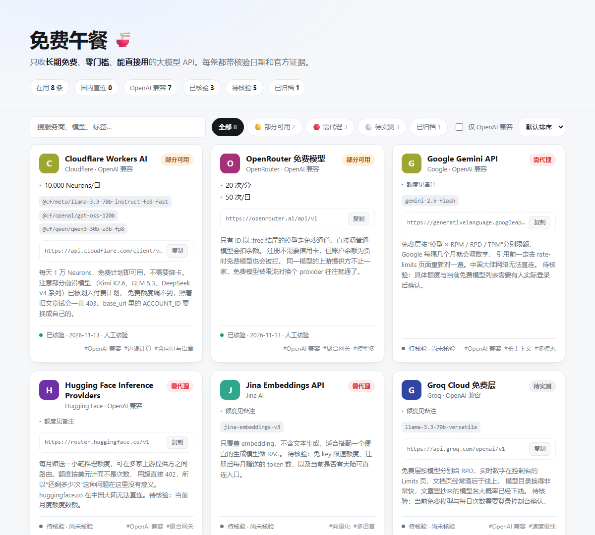

# 免费午餐 · freelunch

> 只收**长期免费**、**零门槛**（不要信用卡、不要实名、不要手机验证）、**能直接用**的大模型 API。

当前 **8** 条在用资源，其中 **3** 条在 60 天内核验过，**5** 条待首次核验。

每个条目都带**核验日期**和**证据链接**。超过 60 天没核验的会自动降级为「待复核」，失效的转入归档——**我们不保留任何一行没人验证过的数据**。

[](https://your-name.github.io/freelunch/)

---

## 为什么会有这个项目

免费额度最大的问题不是少，而是**烂得快**：昨天还能用的免费层，今天已经要绑卡了；收藏夹里的清单，一半链接打不开。

所以这里不是又一张 Markdown 表格，而是一份**有证据、会过期、能自动维护**的数据：

| | 普通清单 | 本项目 |
| --- | --- | --- |
| 数据形态 | 手写 Markdown | YAML 单一数据源，自动生成 README 与网页 |
| 过期处理 | 无 | 超过 60 天自动降级，失效自动归档 |
| 证据 | 无 | 每条必须附官方文档链接，否则不予合并 |
| 门槛标注 | 常有遗漏 | 信用卡 / 实名 / 手机号，任一项为真即不收 |
| 国内可达性 | 基本没写 | 独立字段 + 实测，单独分组 |
| 机器可读 | 无 | `dist/data.json`，可自行二次开发 |

---

## 资源总表

### 🟢 国内可直连

**暂时是空的**——严格按「长期免费 + 零门槛」筛下来，目前没有同时满足「国内可直连」的服务。
这不是漏了，是筛选口径的结果：海外免费层大多要代理，国内厂商又基本都要实名或手机号。
知道符合条件的，欢迎提 PR 补上。

### 🟡 部分可用

国内多数网络可访问，但存在间歇性超时或需特殊 DNS，生产环境请自备重试。

| 服务 | 免费额度 | 代表模型 | OpenAI 兼容 | 国内可达 | 上次核验 |
| --- | --- | --- | --- | --- | --- |
| [Cloudflare Workers AI](https://developers.cloudflare.com/workers-ai/)<br><sub>Cloudflare</sub> | 10,000 Neurons/日 | `@cf/meta/llama-3.3-70b-instruct-fp8-fast`、`@cf/openai/gpt-oss-120b`、`@cf/qwen/qwen3-30b-a3b-fp8` | [✓](https://api.cloudflare.com/client/v4/accounts/{ACCOUNT_ID}/ai/v1) | 🟡 部分可用 | 2026-11-13（0 天前） |
| [OpenRouter 免费模型](https://openrouter.ai/)<br><sub>OpenRouter</sub> | 20 次/分<br>50 次/日 | — | [✓](https://openrouter.ai/api/v1) | 🟡 部分可用 | 2026-11-13（0 天前） |

### 🔴 需要代理

中国大陆网络无法直接访问，需要自备网络出口。

| 服务 | 免费额度 | 代表模型 | OpenAI 兼容 | 国内可达 | 上次核验 |
| --- | --- | --- | --- | --- | --- |
| [Google Gemini API](https://ai.google.dev/)<br><sub>Google</sub> | 见备注 | `gemini-2.5-flash` | [✓](https://generativelanguage.googleapis.com/v1beta/openai/) | 🔴 需代理 | ⏳ 待核验 |
| [Hugging Face Inference Providers](https://huggingface.co/)<br><sub>Hugging Face</sub> | 见备注 | — | [✓](https://router.huggingface.co/v1) | 🔴 需代理 | ⏳ 待核验 |
| [Jina Embeddings API](https://jina.ai/)<br><sub>Jina AI</sub> | 见备注 | `jina-embeddings-v3` | — | 🔴 需代理 | ⏳ 待核验 |

### ⚪ 待实测

还没有人在中国大陆网络下实测过可达性。这正是最容易上手的贡献点。

| 服务 | 免费额度 | 代表模型 | OpenAI 兼容 | 国内可达 | 上次核验 |
| --- | --- | --- | --- | --- | --- |
| [Groq Cloud 免费层](https://groq.com/)<br><sub>Groq</sub> | 见备注 | `llama-3.3-70b-versatile` | [✓](https://api.groq.com/openai/v1) | ⚪ 待实测 | ⏳ 待核验 |
| [Pollinations](https://pollinations.ai/)<br><sub>Pollinations</sub> | 见备注 | — | [✓](https://text.pollinations.ai/openai) | ⚪ 待实测 | ⏳ 待核验 |
| [SambaNova Cloud 免费层](https://cloud.sambanova.ai/)<br><sub>SambaNova</sub> | 20 次/分<br>20 次/日<br>200,000 token/日 | `Meta-Llama-3.3-70B-Instruct`、`DeepSeek-V3.1`、`gpt-oss-120b` | [✓](https://api.sambanova.ai/v1) | ⚪ 待实测 | 2026-11-13（0 天前） |

### 🗄 已归档

下列服务曾经可用，现在因下线、取消免费额度或收紧门槛而不再推荐。

- **GitHub Models**（GitHub）：2026-07-30 起全面下线，playground、模型目录、推理 API 与 BYOK 均已停止服务，官方建议迁往 Azure AI Foundry。这条留作存档，提醒大家别再从旧清单里抄它。


---

## 五分钟用起来

```bash
# 1. 挑一个标了 "国内直连" 且 "OpenAI 兼容" 的服务，去注册拿 key
# 2. 直接用官方 SDK，或者任意 OpenAI 兼容客户端
curl https://api.example.com/v1/chat/completions \
  -H "Authorization: Bearer $FREE_KEY" \
  -H "Content-Type: application/json" \
  -d '{"model": "example-model", "messages": [{"role": "user", "content": "你好"}]}'
```

表格里「OpenAI 兼容」一列点了可直接跳转到对应的 `base_url`，多数客户端只要填这两项就能用。

## 数据怎么用

构建产物是纯静态文件，可以直接当数据源：

```bash
curl -s https://your-name.github.io/freelunch/data.json | jq '.resources[] | select(.cn_access == "direct") | .name'
```

站点本身也是零后端：`dist/` 是纯 HTML/CSS/JS，`python -m http.server -d dist` 即可本地预览。

## 收录规则

进这张表要同时满足：

1. **长期免费**：不是注册赠送的试用额度，不是限时活动。
2. **零门槛**：不要信用卡、不要实名认证、不要手机验证。这一条由构建脚本强制校验，写进去也过不了 CI。
3. **有官方渠道**：必须是服务商自己的公开产品或免费层，不收中转、反代、逆向接口。
4. **有证据**：附官方文档链接和核验日期。

被排除的、以及为什么排除，记在 [docs/EXCLUDED.md](docs/EXCLUDED.md)——**知道什么不能用，和知道什么能用一样重要**。

完整规则见 [docs/POLICY.md](docs/POLICY.md)。

## 贡献

欢迎两种 PR，都不需要写代码：

- **补一条新资源**：复制 `data/llm-api/_template.yaml`，填好提交即可。
- **核验一条旧资源**：把 `verification` 里的日期和证据更新掉，哪怕结论是「它已经不免费了」——这一样是有效贡献。

详见 [CONTRIBUTING.md](CONTRIBUTING.md)。

## 文档

- [收录规则](docs/POLICY.md) — 什么叫"免费午餐"，以及为什么有些服务不收
- [被排除的服务](docs/EXCLUDED.md) — 看起来该收、实际不收的，逐条写了原因
- [核验手册](docs/VERIFY.md) — 怎么核验一条、国内可达性怎么测
- [本地开发](docs/DEVELOPMENT.md) — 构建、目录结构、设计取舍
- [路线图](docs/ROADMAP.md) — 下一步做什么，以及"要不要放宽门槛"的争论

## 免责声明

本项目与所列服务商无任何关联，不收受任何形式的推广费用。免费额度随时可能调整，**以官方文档为准**；因使用产生的任何后果由使用者自行承担。详见 [DISCLAIMER.md](DISCLAIMER.md)。

## 许可证

MIT。数据可自由取用、二次分发，无需署名。

---

<sub>本文件由 `scripts/build.py` 根据 `data/` 自动生成，请勿直接编辑。最后构建：2026-11-13</sub>
